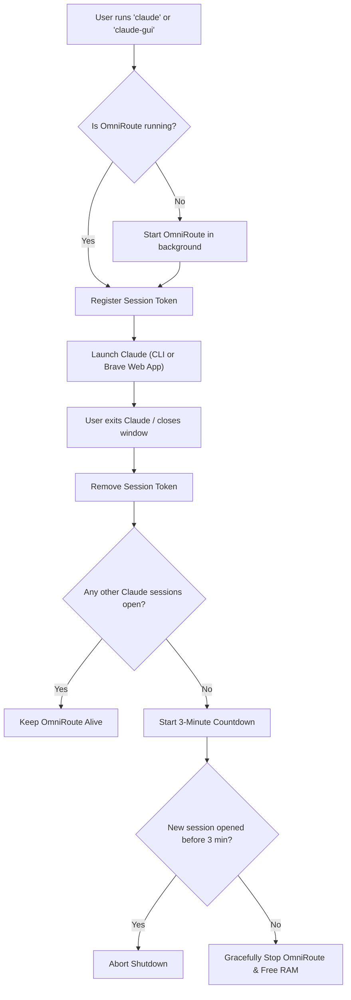

# 🚀 PC Papa — Linux Storage, RAM & Watchdog Optimization Guide

Welcome to the **PC Papa** system optimization manual. This repository contains the architecture, maintenance procedures, and automated watchdog scripts engineered to keep your Linux machine (CachyOS / Arch) fast, clean, and resource-efficient.

---

## 📋 Table of Contents
1. [System Specifications & Health Profile](#1-system-specifications--health-profile)
2. [Disk Storage Accounting (Where Did 512 GB Go?)](#2-disk-storage-accounting-where-did-512-gb-go)
3. [RAM & Memory Architecture (The ZRAM Multiplier)](#3-ram--memory-architecture-the-zram-multiplier)
4. [Watchdog 1: Dev Services Auto-Sleeper (5-Minute Inactivity)](#4-watchdog-1-dev-services-auto-sleeper-5-minute-inactivity)
5. [Watchdog 2: OmniRoute Smart Lifecycle Controller (3-Minute Inactivity)](#5-watchdog-2-omniroute-smart-lifecycle-controller-3-minute-inactivity)
6. [Container Controller: The `n8n` CLI](#6-container-controller-the-n8n-cli)
7. [Installation & One-Click Deployment](#7-installation--one-click-deployment)
8. [Maintenance & Command Reference Card](#8-maintenance--command-reference-card)

---

## 1. System Specifications & Health Profile

* **Operating System**: CachyOS (Arch Linux kernel optimized)
* **Processor Architecture**: x86_64
* **Total Physical RAM**: **7.1 GiB usable** (8 GB physical, remainder reserved for hardware/iGPU)
* **Main Storage Drive**: **473 GiB formatted** NVMe SSD (Btrfs subvolume layout)
* **Swap Configuration**: **19.1 GiB total** (7.1 GiB ultra-fast ZRAM + 12 GiB disk swapfile)

---

## 2. Disk Storage Accounting (Where Did 512 GB Go?)

Storage manufacturers define **512 GB** in decimal ($512 \times 10^9$ bytes). When formatted by Linux into binary gigabytes (GiB), the physical capacity is **476.9 GiB**.

### Storage Distribution Map

| Category | Size | What's Inside |
| :--- | :--- | :--- |
| **Available / Free** | **~105 GB** | Unused space ready for files and games (up from 54 GB) |
| **`~/Downloads`** | **~152 GB** | Large offline `.zim` archives (68 GB), Movies (55 GB), ISOs |
| **Linux OS & System Apps** | **~70 GB** | `/usr` (30 GB), `/opt` (20 GB: DaVinci Resolve, CUDA, Chrome), `/var` (20 GB) |
| **Virtual Machines** | **33 GB** | `Windows 10 x64` VM (25 GB), `Ubuntu 64-bit` VM (8.7 GB) |
| **AI Models & Environments** | **26 GB** | `comfyui/models/checkpoints` (19 GB), ComfyUI venv (7 GB) |
| **`~/Startups` & Projects** | **~43 GB** | `Startups/YT` (23 GB), codebases, and local git repositories |
| **User Data & Configs** | **~35 GB** | `~/.cache`, `~/.local`, `~/.config`, npm, Python caches |
| **Formatting Difference + `/boot`** | **~39 GB** | Hardware decimal conversion loss + 4 GB EFI boot partition |
| **Total** | **~512 GB** | Full storage accounted for |

### Safe Cache Maintenance Commands
To prevent package caches from silently eating 40+ GB in the future:
```bash
# Keep only current version of installed packages:
sudo paccache -r

# Clean uninstalled AUR builds from yay & paru:
yay -Sc
paru -Sc

# Clear Paru downloaded .deb / git clone source trees:
rm -rf ~/.cache/paru/clone/*

# Clear Python package build caches:
uv cache clean
pip cache purge

# Clean broken/interrupted temporary pacman downloads:
sudo rm -f /var/cache/pacman/pkg/download-* /var/cache/pacman/pkg/*.part
```

---

## 3. RAM & Memory Architecture (The ZRAM Multiplier)

On CachyOS, your swap is primarily handled by **ZRAM (`/dev/zram0`)** using the high-performance `zstd` compression algorithm.

### Why RAM Looked "Full" Before:
1. **Compressed Data inside RAM**: When idle processes are swapped, they are **NOT** written to slow disk; they are compressed inside a slice of your physical RAM.
2. **The Multiplier Effect**: When OmniRoute (540 MB swap) or MongoDB (120 MB swap) were running 24/7, their swapped memory stayed pinned inside your physical RAM.
3. **The Result**: Turning off idle services completely purges their swapped pages, shrinking the compressed ZRAM block and returning **several hundred megabytes of true physical RAM** back to your system.

---

## 4. Watchdog 1: Dev Services Auto-Sleeper (5-Minute Inactivity)

* **Script Location**: [`scripts/dev-services-sleeper.sh`](file:///home/siakshit/Downloads/PC%20Papa/scripts/dev-services-sleeper.sh) (installed to `~/.local/bin/dev-services-sleeper.sh`)
* **Trigger**: Systemd timer running once every minute (`dev-services-sleeper.timer`).

### Monitored Services & Rules:
1. **Docker**: Checks active container count (`docker ps -q`). If `0` running containers for 5 minutes $\rightarrow$ stops `docker.service`.
2. **PostgreSQL**: Checks active TCP connections on port `5432`. If `0` connections for 5 minutes $\rightarrow$ stops `postgresql.service`.
3. **MongoDB**: Checks active TCP connections on port `27017`. If `0` connections for 5 minutes $\rightarrow$ stops `mongodb.service`.
4. **Ollama**: Checks loaded models in memory (`ollama ps`) and active port `11434` connections. If idle for 5 minutes $\rightarrow$ stops `ollama.service`.

> **Note on Dev Servers**: If your local Node, Python, or Go dev server has an open connection pool to Postgres or MongoDB, the connection count is $> 0$, keeping the database alive. The 5-minute countdown only begins once you stop your dev server (`Ctrl+C`).

---

## 5. Watchdog 2: OmniRoute Smart Lifecycle Controller (3-Minute Inactivity)

* **Script Location**: [`scripts/omniroute-manager.sh`](file:///home/siakshit/Downloads/PC%20Papa/scripts/omniroute-manager.sh) (installed to `~/.local/bin/omniroute-manager`)
* **Wrappers**: `claude-cli` (and `claude`), `claude-gui`.



### Features:
* **Instant Wakeup**: If OmniRoute is asleep, it starts it in the background and verifies port `20128` responds before launching Claude.
* **Session Tracking**: Supports opening multiple terminal tabs or GUI windows simultaneously without fighting over the daemon.
* **3-Minute Grace Period**: Gives you 3 minutes to switch branches, reopen a tab, or run another command without waiting for OmniRoute to start up again.
* **Desktop App Entry**: Includes `~/.local/share/applications/claude-gui.desktop` so you can launch Claude from the KDE Application Launcher.

---

## 6. Container Controller: The `n8n` CLI

* **Script Location**: [`scripts/n8n.sh`](file:///home/siakshit/Downloads/PC%20Papa/scripts/n8n.sh) (installed to `~/.local/bin/n8n`)

Instead of keeping Docker and the n8n automation container running 24/7, control it on demand:

```bash
# Start n8n (automatically wakes Docker if asleep):
n8n start

# Stop n8n (allows Docker to auto-sleep after 5 minutes):
n8n stop

# Check container status:
n8n status

# Follow container logs:
n8n logs

# Restart container:
n8n restart
```

---

## 7. Installation & One-Click Deployment

Everything is automated via the master install script in this directory.

### Step 1: Install User Tools & Watchdogs
```bash
cd ~/Downloads/PC\ Papa
./install.sh
```
This installs:
* `n8n` $\rightarrow$ `~/.local/bin/n8n`
* `omniroute-manager` $\rightarrow$ `~/.local/bin/omniroute-manager`
* `claude-cli` & `claude` $\rightarrow$ `~/.local/bin/claude-cli`
* `claude-gui` $\rightarrow$ `~/.local/bin/claude-gui`
* `claude-gui.desktop` $\rightarrow$ `~/.local/share/applications/`
* Disables OmniRoute 24/7 autostart in `~/.config/autostart/omniroute.desktop`

### Step 2: Enable System-Wide 5-Minute Auto-Sleeper (Requires sudo)
```bash
sudo ~/.local/bin/setup-on-demand-services.sh
```
This configures:
* `docker.socket` (Docker activates on demand).
* `dev-services-sleeper.service` & `dev-services-sleeper.timer` (runs every 60s).

---

## 8. Maintenance & Command Reference Card

| Action | Command |
| :--- | :--- |
| **Run Claude Code CLI** | `claude` *(or `claude-cli`)* |
| **Run Claude Web App** | `claude-gui` |
| **Check OmniRoute Watchdog Status** | `omniroute-manager status` |
| **Start / Stop n8n Container** | `n8n start` / `n8n stop` |
| **Check Running Dev Services** | `systemctl is-active docker postgresql mongodb ollama` |
| **Check Active Listening Ports** | `ss -tulpn` |
| **Check Current RAM & Swap** | `free -h` |
| **Check ZRAM Compression Ratio** | `zramctl` |
| **Check Disk Free Space** | `df -h /` |
