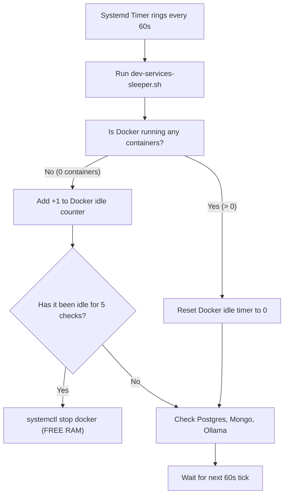

# 🐕 How Watchdogs Work & How to Fix Them

This guide explains how automated background watchdogs work in Linux in plain English, how the two watchdogs in this project protect your RAM, and how you can easily tweak or fix them yourself.

---

## 🏢 1. The Real-World Analogy: The Night Security Guard

Imagine a large office building with air conditioning units and lights in empty conference rooms. 

If nobody turns off the AC when they leave at 5:00 PM, the building wastes electricity all night long.
* **Without a watchdog**: You have to remember to walk to every room and manually flip the switches. If you forget, the power runs 24/7.
* **With a watchdog**: A security guard walks through every floor **once every 60 seconds**.
  * The guard checks: *"Is anyone inside this room?"*
  * If the room has been empty for **5 checks in a row** (5 minutes), the guard flips off the lights and AC.
  * The moment an employee walks into the room, the lights turn back on instantly!

In Linux, that security guard is called a **Watchdog Script**, and the building manager who schedules the guard's rounds is called **Systemd**.

---

## 🔍 2. Watchdog #1: `dev-services-sleeper.sh` (The 5-Minute Database & Docker Guard)

* **Location on your PC**: `~/.local/bin/dev-services-sleeper.sh`
* **Trigger**: A systemd timer (`dev-services-sleeper.timer`) that runs it once every 60 seconds.

### How it makes decisions (Step-by-Step):



### Line-by-Line Breakdown: How the Code Works

Look at this snippet from the actual script:
```bash
# 1. Check if PostgreSQL has any active client connections
pg_conns=$(ss -t state established '( sport = :5432 )' 2>/dev/null | grep -v Recv-Q | wc -l)

if [ "$pg_conns" -gt 0 ]; then
  # Someone is using the database! Delete the idle counter file:
  rm -f /tmp/dev-services-idle/postgresql.idle
else
  # Nobody is using the database. Read the counter and add +1:
  count=$(($(cat /tmp/dev-services-idle/postgresql.idle) + 1))
  echo "$count" > /tmp/dev-services-idle/postgresql.idle

  # If it reached 5 minutes (5 checks):
  if [ "$count" -ge 5 ]; then
    systemctl stop postgresql
    rm -f /tmp/dev-services-idle/postgresql.idle
  fi
fi
```

### 🛠️ How to Customize It (e.g. Change 5 minutes to 15 minutes)
If you want the database to wait 15 minutes instead of 5 minutes before sleeping:
1. Open the file in an editor: `nano ~/.local/bin/dev-services-sleeper.sh`
2. Look for the line:
   ```bash
   if [ "$count" -ge 5 ]; then
   ```
3. Change `5` to `15`:
   ```bash
   if [ "$count" -ge 15 ]; then
   ```
4. Save and exit (`Ctrl + O`, `Enter`, `Ctrl + X`). Done!

---

## ⚡ 3. Watchdog #2: `omniroute-manager.sh` (The 3-Minute Claude Guard)

* **Location on your PC**: `~/.local/bin/omniroute-manager`
* **Triggered by**: `claude-cli` (or `claude`) and `claude-gui`.

### How it works:
1. **When you launch Claude**:
   * It checks: *"Is OmniRoute running on port 20128?"*
   * If NO: It starts OmniRoute in the background and waits until port 20128 responds.
   * It drops a tiny session token inside `/tmp/omniroute-sessions/` (e.g. `cli_12345`).
   * If a shutdown countdown was currently ticking, it **cancels it immediately**.
2. **While you work**:
   * Even if you open 5 different terminal tabs running Claude simultaneously, each tab has its own token. OmniRoute stays alive.
3. **When you close Claude**:
   * Your session token is deleted.
   * It checks: *"Are there any other Claude sessions still open?"*
   * If NO: It starts a **3-minute countdown timer** in the background (`sleep 180`).
   * If 3 minutes pass and you haven't opened Claude again, it runs `omniroute stop` to free up ~650 MB of RAM!

---

## 🔧 4. How to Check If a Watchdog is Healthy

If you ever wonder *"Is my watchdog working right now?"*, run these simple commands:

### Check the 5-Minute Service Watchdog:
```bash
# Check if the timer is active:
systemctl is-active dev-services-sleeper.timer
# (Should print: active)

# View the last time the watchdog ran:
systemctl list-timers dev-services-sleeper.timer
```

### Check the OmniRoute Watchdog:
```bash
omniroute-manager status
```
**What the output means:**
* `OmniRoute: RUNNING on port 20128` $\rightarrow$ Server is awake.
* `Active Claude Sessions: 0` $\rightarrow$ No Claude terminals currently open.
* `Pending Shutdown: YES (countdown in progress)` $\rightarrow$ The 3-minute sleep timer is actively counting down!

---

## 🚑 5. How to Fix a Stuck Watchdog

### Problem 1: "A service didn't go to sleep"
* **Check if something is secretly connected**:
  ```bash
  # Check if an app is connected to Postgres:
  ss -t state established '( sport = :5432 )'
  # Check if an app is connected to Mongo:
  ss -t state established '( sport = :27017 )'
  ```
  *If a local backend dev server (Node/Python) is running in the background, it holds the connection open! Close the dev server and the watchdog will put the database to sleep.*

### Problem 2: "OmniRoute won't shut down or port 20128 is stuck"
Run this one command to force-kill any orphaned processes:
```bash
pkill -9 -f "omniroute.mjs"
rm -f /tmp/omniroute-timer.pid /tmp/omniroute-sessions/*
```
Next time you type `claude`, it will start fresh and clean!
