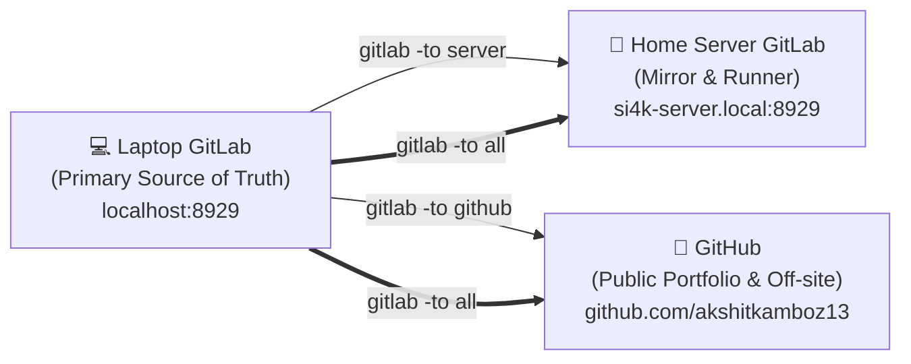

# 🦊 GitLab CE on Laptop: Lightweight On-Demand Guide

> **Why this guide exists**: GitLab Community Edition is a world-class self-hosted DevOps platform, but out-of-the-box it is notorious for eating **4 to 6 GB of RAM** because it runs heavy metrics, Prometheus, Grafana, and dozens of background workers.
>
> On a modern 8 GB laptop (like your CachyOS / Arch machine), running default GitLab 24/7 would slow down your desktop.
> 
> The **PC Papa `gitlab` CLI** solves this by:
> 1. **Running GitLab On-Demand**: Start it only when you code, and stop it completely when done (`gitlab stop` frees 100% of RAM and CPU).
> 2. **Low-Memory Tuning**: Limits Puma web workers to 2, caps Sidekiq concurrency to 5, and turns off unnecessary enterprise exporters (Prometheus, Grafana, Node Exporter), cutting idle memory usage down to **~2 GB**.

---

## ⚡ Quick Reference Commands

### Lifecycle & Administration
| Command | What it Does |
| :--- | :--- |
| **`gitlab start`** | Boots Docker (if stopped) and launches GitLab on port `8929`. |
| **`gitlab stop`** | Cleanly shuts down GitLab and instantly frees all RAM & CPU. |
| **`gitlab status`** | Shows whether GitLab is running, healthy, and live RAM consumption. |
| **`gitlab logs`** | Streams live initialization and application logs. |
| **`gitlab password`** | Retrieves the auto-generated initial `root` password. |
| **`gitlab open`** | Opens `http://localhost:8929` in your default browser. |
| **`gitlab restart`** | Restarts the GitLab container. |
| **`gitlab destroy`** | Deletes the container and all persistent data volumes (prompted). |

### Tri-Node Replication & Sync
| Command | What it Does |
| :--- | :--- |
| **`gitlab -to server`** | Pushes the current branch to Home Server GitLab (`si4k-server.local:8929`). |
| **`gitlab -to github`** | Pushes the current branch to GitHub (`github.com/akshitkamboz13`). |
| **`gitlab -to laptop`** | Pushes the current branch to Laptop GitLab (`localhost:8929`). |
| **`gitlab -to all`** | Replicates current branch across **all 3 nodes** in sequence (Laptop ➔ Server ➔ GitHub). |
| **`gitlab sync-remotes [repo]`** | Automatically configures `laptop`, `server`, and `github` remotes in current repository. |
| **`gitlab sync-github`** | Automatically mirrors all repositories from your GitHub account to both GitLabs. |

---

## 🚀 1. Starting GitLab for the First Time

In any terminal window, simply run:
```bash
gitlab start
```

### What Happens Behind the Scenes:
1. Docker automatically pulls `gitlab/gitlab-ce:latest` (if not already downloaded).
2. It creates 3 persistent Docker volumes to protect your code and configurations:
   * `gitlab_config` ➔ `/etc/gitlab`
   * `gitlab_logs` ➔ `/var/log/gitlab`
   * `gitlab_data` ➔ `/var/opt/gitlab` (stores all Git repositories)
3. It launches the container with non-conflicting ports:
   * **Web UI**: `http://localhost:8929`
   * **SSH Git Clones**: Port `2224` (so it never clashes with host SSH on port 22).

> [!NOTE]
> **First Boot Patience**:
> On its very first startup, GitLab initializes PostgreSQL database schemas and compiles Ruby assets. This takes **2 to 3 minutes**.
> You can watch the startup progress live with:
> ```bash
> gitlab logs
> ```
> Once you see Puma start and HTTP requests flow, GitLab is ready!

---

## 🔑 2. Logging In as Administrator

1. Retrieve your root password:
   ```bash
   gitlab password
   ```
2. Open GitLab in your browser:
   ```bash
   gitlab open
   ```
   *(Laptop: `http://localhost:8929` | Server: `http://si4k-server.local:8929`)*.
3. Sign in with your administrator account:
   * **Username or Email**: `akshitkamboz13` or `akshitkamboz13@gmail.com`
   * **Password**: *(your password or initial password from step 1)*.
4. **Change your password**:
   * Click your avatar in the top-left corner ➔ **Edit profile** ➔ **Password**.

---

## 🌿 3. Cloning & Pushing via SSH (Port 2224)

Because your laptop's standard SSH port `22` is reserved for system access, GitLab uses port **`2224`** for Git clones.

### Step 1: Add Your SSH Key to GitLab
1. On your laptop, display your public SSH key:
   ```bash
   cat ~/.ssh/id_ed25519.pub
   ```
2. Open GitLab ➔ Click Avatar ➔ **Preferences** ➔ **SSH Keys** ➔ **Add new key** ➔ Paste key.

### Step 2: Configure SSH Client Shortcut
To make `git clone` work cleanly without typing `:2224` every time, add this to `~/.ssh/config`:
```ssh
Host localhost-gitlab
    HostName localhost
    Port 2224
    User git
    IdentityFile ~/.ssh/id_ed25519
```

Now you can clone any project effortlessly:
```bash
git clone git@localhost-gitlab:your-username/my-project.git
```
*(Or standard HTTP clone: `git clone http://localhost:8929/your-username/my-project.git`)*.

---

## 🛑 4. Stopping GitLab & Saving RAM

When you are done developing for the day, run:
```bash
gitlab stop
```
* **Memory impact**: Immediately releases all RAM back to your operating system.
* **Data safety**: All your repositories, commits, issues, and pipelines remain stored safely in Docker volumes.
* Whenever you need it again tomorrow, simply run `gitlab start`—it will boot up in under 30 seconds!

---

## 🩺 5. Troubleshooting & Diagnostics

### Problem 1: "502 Whoops, GitLab is taking too much time to respond"
* **Cause**: Puma or PostgreSQL is still finishing its boot sequence.
* **Fix**: Wait 30 seconds and refresh the browser. Check `gitlab logs` to see if migrations are completing.

### Problem 2: Forgot Root Password After 24 Hours
If the initial password file has expired and you forgot your password:
```bash
docker exec -it gitlab gitlab-rake "gitlab:password:reset[root]"
```
GitLab will prompt you directly in the terminal to enter a new root password.

### Problem 3: Inspect Memory Usage
To verify how much RAM GitLab is consuming right now:
```bash
gitlab status
```
It displays live CPU %, Memory MB, and Memory % without opening full terminal monitors.

---

## 🏰 6. Running GitLab on Your Home Server (`si4k-server.local`)

GitLab is also installed on your home server **`si4k-server.local`**!

### Key Differences on the Server:
1. **Network-Wide Access**:
   Unlike your laptop (which defaults to `localhost`), the server automatically exposes GitLab to your entire home network on:
   ```text
   http://si4k-server.local:8929
   (or http://192.168.31.250:8929)
   ```
2. **LAN Git Cloning**:
   You can clone projects from your laptop directly to/from the server:
   ```bash
   git clone ssh://git@si4k-server.local:2224/username/project.git
   ```
3. **Remote Control from Your Laptop**:
   You can manage the server's GitLab without opening an interactive SSH terminal:
   ```bash
   # Check status on the server:
   ssh si4k@si4k-server.local gitlab status

   # Start or stop GitLab on the server:
   ssh si4k@si4k-server.local gitlab start
   ssh si4k@si4k-server.local gitlab stop

   # Fetch root password from the server:
   ssh si4k@si4k-server.local gitlab password
   ```

4. **Add Server Git Shortcut (`~/.ssh/config`)**:
   Add this to your laptop's `~/.ssh/config`:
   ```ssh
   Host gitlab-server
       HostName 192.168.31.250
       Port 2224
       User git
       IdentityFile ~/.ssh/id_ed25519
   ```
   Now clone easily with:
   ```bash
   git clone git@gitlab-server:akshitkamboz13/repo.git
   ```

---

## 🔄 7. Tri-Node Git Ecosystem: Laptop ➔ Server ➔ GitHub

Your workflow connects **Laptop GitLab**, **Home Server GitLab**, and **GitHub** into a unified, redundant development ecosystem.

### Node Architecture & Responsibilities:



1. **Laptop GitLab (Primary Source of Truth)**:
   - Where you write code, commit branches, open issues, and test pipelines.
   - **Golden Rule**: Always commit and develop on Laptop GitLab first.

2. **Home Server GitLab (Persistent Local Mirror & Runner)**:
   - Runs 24/7 on your home network (`192.168.31.250`).
   - Acts as a local mirror and continuous backup even when your laptop is offline.
   - Hosts CI/CD runners and persistent workers.

3. **GitHub (Public Identity & External Mirror)**:
   - Hosts your public open-source portfolio and external collaborator contributions.

---

### Daily Synchronization Workflow:

#### 1. Setup Remotes in Any Project:
Inside any project folder (e.g. `PC Papa`), wire up all three remotes in one command:
```bash
gitlab sync-remotes
```
This automatically establishes:
* `laptop` ➔ `git@gitlab-laptop:akshitkamboz13/<project>.git`
* `server` ➔ `git@gitlab-server:akshitkamboz13/<project>.git`
* `github` ➔ `git@github.com:akshitkamboz13/<project>.git`

#### 2. Selective Pushing:
* Push only to Home Server:
  ```bash
  gitlab -to server
  ```
* Push only to GitHub:
  ```bash
  gitlab -to github
  ```
* Push to Laptop:
  ```bash
  gitlab -to laptop
  ```

#### 3. Full Tri-Node Synchronization:
To sync your current working branch across all three destinations in sequence:
```bash
gitlab -to all
```
The CLI validates branch heads and provides clear pass/fail status per node.

#### 4. Mirroring All GitHub Repositories:
To bulk-mirror all 80+ repositories from your GitHub account to both Laptop and Server GitLabs:
```bash
gitlab sync-github
```
GitLab native push-to-create automatically initializes missing repositories on both instances without requiring manual web UI creation.

